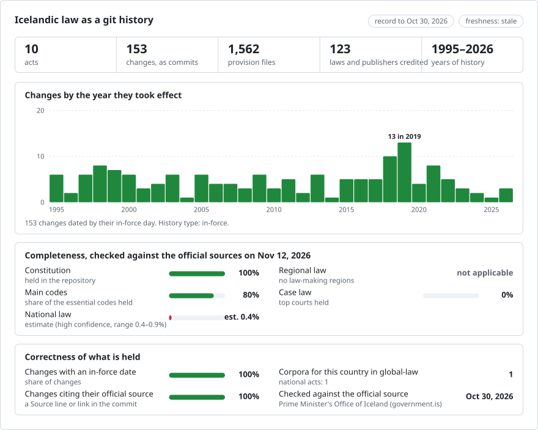

# Iceland: law history in git

**English** · **[Eða lesið á íslensku](README.md)**

<picture>
<source media="(prefers-color-scheme: dark)" srcset="data/effort-dark.svg">

</picture>

The law of Iceland as a git history: one file per article, one commit per amending law on the day it took effect, and that law as the commit's author. `git blame` names the law behind every line; `git log` lists every change to an article; picking a date gives the text in force that day.

Part of [lexifina/global-law](https://github.com/lexifina/global-law), one git history for every country's law: this is Iceland's national law, which global-law reads at `iceland/national/acts/`.

**What is in it now:** six acts from Lagasafn, the Althingi's consolidated law collection, with 163 versions since 1995 (the Constitution, the General Penal Code, the Criminal Procedure Act, the Civil Procedure Act, the Contracts Act and the Trade Unions and Industrial Disputes Act); and the Government of Iceland's English translations of four acts (the Constitution, the General Penal Code, the Contracts Act and the Public Limited Companies Act), one version each. Each act's folder has a `README.md` listing every article, how often it changed and when ([`log-um-stettarfelog-og-vinnudeilur/README.md`](log-um-stettarfelog-og-vinnudeilur/README.md)); [`REPRODUCE.md`](REPRODUCE.md) lists every act with its versions.

Each act is a folder named after its title (`log-um-stettarfelog-og-vinnudeilur/` is the Lög um stéttarfélög og vinnudeilur, nr. 80/1938, the Trade Unions and Industrial Disputes Act, the nearest Iceland has to a labour code); each article is a file (`gr-020.md` is 20. gr.). The English translations have English folder names (`constitution/`) and files (`art-001.md`).

The Icelandic texts are as Lagasafn prints them. The English texts are translations published by the Government of Iceland; the Icelandic text governs.

## Questions as git commands

| Question | Command |
| --- | --- |
| Every change to Article 20 of the Trade Unions and Industrial Disputes Act | `git log -p --word-diff -- log-um-stettarfelog-og-vinnudeilur/gr-020.md` |
| Which law wrote each line of Article 20? | `git blame log-um-stettarfelog-og-vinnudeilur/gr-020.md` |
| Every version of the Trade Unions and Industrial Disputes Act, with the day each took effect | `git log --format="%h %(trailers:key=In-force,valueonly,separator=) %an" -- log-um-stettarfelog-og-vinnudeilur` |
| Article 20 as in force on 1 January 2015 | `python tools/on.py 2015-01-01 log-um-stettarfelog-og-vinnudeilur 20` |

**Outside git**, we also host this record publicly, for free:

- **[Ask Claude about Icelandic law](https://global-law.lexifina.com/v1/try_claude?country=iceland)**: opens Claude with a first question ready.
- **[Ask ChatGPT](https://global-law.lexifina.com/v1/try_chatgpt?country=iceland)**: the same question in ChatGPT.
- **[Search Icelandic law on our site](https://lexifina.com/law?country=iceland&q=kjarasamning)**: a search for "kjarasamning" (collective agreement), with each provision's text and its versions, no account needed.
- **[Developer REST API](https://global-law.lexifina.com/v1/search_law?query=kjarasamning&jurisdiction=iceland)**: the same search as JSON, with no key. See the [documentation here](https://lexifina.com/api/global-law).

Both assistants read the record through the free Global law connector (MCP, `https://global-law.lexifina.com/mcp`); the first time, the chat gives you the link that adds it. Ask in Icelandic or in English.

**Host it yourself easily.** All it takes is git and Python, and the tools run on your machine:

```sh
git clone --depth 1 https://github.com/lexifina/global-law && cd global-law
python3 tools/countries.py add iceland/national/acts
python3 tools/law.py show 2026-01-01 iceland/national/acts/log-um-stettarfelog-og-vinnudeilur/gr-020.md
```

Opened in Claude Code, Cursor, VS Code or Codex, the clone also starts a local MCP server with the same tools ([MCP.md](https://github.com/lexifina/global-law/blob/main/MCP.md)).

## Dates

Each commit is dated at noon, Atlantic/Reykjavik, on the day the change took effect, and carries it in its `In-force:` trailer:

- for a change to an article, the day the act's own list of amending laws says the laws newly named in the article's footnotes took effect ("tóku gildi"), the latest if there are several;
- for a change no new footnote explains (21 commits), the day the Lagasafn edition is consolidated to;
- for an act's first version, the consolidation day of the oldest edition read (1 October 1995; 1 October 2008 for the Criminal Procedure Act); for an English translation, the day of the last amendment it includes.

Each change is credited to the amending law the footnotes name, as Lagasafn prints it (`Lög nr. 42/2022`); changes no footnote explains are credited to `Alþingi (Lagasafn)`. An act's first version is the "oldest version available", credited to the Althingi as publisher; each English translation is credited to its publisher.

## How it is checked

- `tools/verify_lagasafn.py` checks the Icelandic texts against the Lagasafn editions they were read from: every line of the newest text occurs in the edition's page, and replaying the versions gives each edition's text on its consolidation day, except where a change is dated to a later in-force day.
- `tools/check_repo.py` reads every version back from git on the day it took effect and on the day before and compares it with the corpus (167 versions of 10 acts, 0 mismatches); it also checks that every commit's trailers parse, that there are no merge commits and that no commit date goes backwards or lies in the future.
- A second build from the same corpus gave identical hashes for all 153 commits and 286 tags. The results are in [`REPRODUCE.md`](REPRODUCE.md).
- History is append-only: `tools/append.py` adds newer versions on top and never rewrites a published commit.

## What it does not show

- **Most Icelandic law.** Six acts of Lagasafn are here; the other acts in force, regulations (reglugerðir) and local rules are not.
- **Versions before 1995.** Each act's first commit is the oldest Lagasafn edition read (edition 119, consolidated to 1 October 1995), not the act as first published in Stjórnartíðindi.
- **Chapter headings and temporary provisions** (ákvæði til bráðabirgða) are left out; "…" marks a passage the source shows as repealed.
- **Which law made some changes.** The 21 commits no new footnote explains are credited to the publisher.
- **Current English translations.** Each stops at the last amendment its publisher included: the Constitution at 24 June 1999, the General Penal Code at Act 141/2018, the Contracts Act at Act 108/2006 and the Public Limited Companies Act at 1 May 2011.
- **Case law, treaties and EEA law.** None is here.

## Sources

| Source | Kind | Past versions | Notes |
| --- | --- | --- | --- |
| [Lagasafn](https://www.althingi.is/lagasafn/) (Alþingi) | Consolidated law collection | yes, up to 67 editions per act since 1995 | Read from Internet Archive copies; the text authenticated in Stjórnartíðindi governs |
| [Government of Iceland](https://www.government.is) (Prime Minister's Office, Ministry of Justice) | English translations | one version each | Not the authentic text |

## Licence

See [`LICENSE`](LICENSE). Icelandic laws are not protected by copyright (Höfundalög nr. 73/1972, 9. gr.); the Government of Iceland's sites allow free use of their English translations with acknowledgement of the source. Lexifina's arrangement, commit messages and tools are under CC BY 4.0.

No AI model wrote, translated or corrected legal text, and none runs when the history is built; the scripts were written by an AI model (see [`REPRODUCE.md`](REPRODUCE.md)).

## More

From [lexifina/global-law](https://github.com/lexifina/global-law):

- [FEATURES.md](https://github.com/lexifina/global-law/blob/main/FEATURES.md): every feature, and what every corpus must support (`git blame`, `law.py`, the MCP tools)
- [FAQ.md](https://github.com/lexifina/global-law/blob/main/FAQ.md): questions and answers · [CONTRIBUTING.md](https://github.com/lexifina/global-law/blob/main/CONTRIBUTING.md): proposing changes · [MCP.md](https://github.com/lexifina/global-law/blob/main/MCP.md): the MCP server · [REPRODUCE.md](https://github.com/lexifina/global-law/blob/main/REPRODUCE.md): how it was built · [CHANGELOG.md](https://github.com/lexifina/global-law/blob/main/CHANGELOG.md)
- [FRESHNESS.md](https://github.com/lexifina/global-law/blob/main/FRESHNESS.md): how current each corpus is · [Monitoring](https://github.com/lexifina/global-law/tree/main/monitoring): whether updates are running · [WATCHING.md](https://github.com/lexifina/global-law/blob/main/WATCHING.md): how each official source is watched for changes
- [performance/](https://github.com/lexifina/global-law/tree/main/performance): how fast the tools are, measured
- [visualisations/](https://github.com/lexifina/global-law/tree/main/visualisations): charts and bridges across the world's law
- [Vulnerabilities](https://github.com/lexifina/global-law/tree/main/vulnerabilities): mistakes in legislation as published
