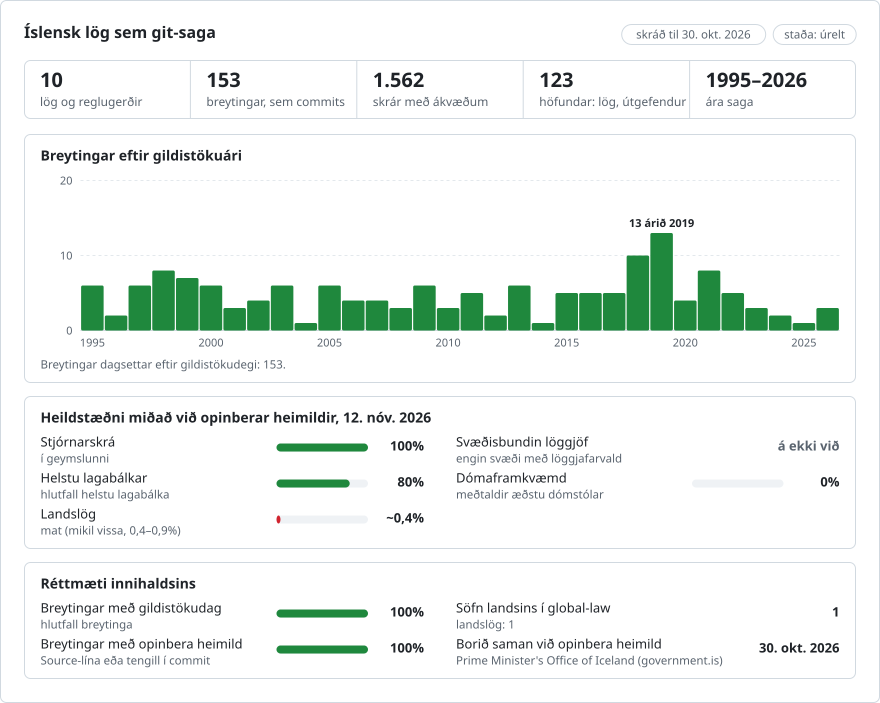

# Ísland: lagasaga í git

**Íslenska** · [English](README.en.md)

<picture>
<source media="(prefers-color-scheme: dark)" srcset="data/is/effort-dark.svg">

</picture>

Hluti af [lexifina/global-law](https://github.com/lexifina/global-law), einni git-sögu fyrir lög allra landa: þetta eru landslög Íslands, sem global-law les í `iceland/national/acts/`.

Lög Íslands sem git-saga: ein skrá fyrir hvert ákvæði, og lögin sem gerðu hverja breytingu eru skráð sem höfundur færslunnar (commit), svo að `git blame` nefnir lögin að baki hverri línu.

Geymslan fylgir sameiginlegri hönnun [lexifina/global-law](https://github.com/lexifina/global-law), sem setur hana í `is/`.

**Innihald nú (fyrsta smíð, sótt 2026-10-29)**

| Mappa | Lög | Útgáfur | Tungumál |
| --- | --- | ---: | --- |
| `constitution/` | Stjórnarskrá lýðveldisins Íslands (nr. 33, 17. júní 1944) | 1 | Ensk þýðing sem forsætisráðuneytið gefur út, með breytingum til 24. júní 1999 (síðari breytingar eru ekki í þýðingunni) |
| `general-penal-code/` | Almenn hegningarlög, nr. 19/1940 | 1 | Ensk þýðing sem dómsmálaráðuneytið gefur út (hýst á ministryoffinance.is), með breytingum til og með lögum nr. 141/2018 (tóku gildi 1. janúar 2019); sótt 2026-10-30 |
| `contracts-act/` | Lög um samningsgerð, umboð og ógilda löggerninga, nr. 7/1936 | 1 | Ensk þýðing birt á stjornarradid.is (Stjórnarráð Íslands), með breytingum til og með lögum nr. 108/2006 (tóku gildi 1. nóvember 2006); sótt 2026-10-30 |
| `public-limited-companies-act/` | Lög um hlutafélög, nr. 2/1995 | 1 | Ensk þýðing birt á government.is, með breytingum til 1. maí 2011; sótt 2026-10-30 |

**Íslenskir textar með dagsettri sögu (bætt við 2026-10-30)**

| Mappa | Lög | Saga |
| --- | --- | --- |
| `stjornarskra/` | Stjórnarskrá lýðveldisins Íslands, nr. 33/1944 | Allar útgáfur Lagasafns lesnar, frá 1995 |
| `almenn-hegningarlog/` | Almenn hegningarlög, nr. 19/1940 | Allar útgáfur Lagasafns lesnar, frá 1995 |
| `log-um-medferd-sakamala/` | Lög um meðferð sakamála, nr. 88/2008 | Frá fyrstu útgáfu laganna (tóku gildi 1. janúar 2009) |
| `log-um-medferd-einkamala/` | Lög um meðferð einkamála, nr. 91/1991 | Allar útgáfur Lagasafns lesnar, frá 1995 |
| `samningalog/` | Lög um samningsgerð, umboð og ógilda löggerninga, nr. 7/1936 | Allar útgáfur Lagasafns lesnar, frá 1995 |
| `log-um-stettarfelog-og-vinnudeilur/` | Lög um stéttarfélög og vinnudeilur, nr. 80/1938 | Allar útgáfur Lagasafns lesnar, frá 1995 |

Þetta eru frumtextarnir á íslensku, úr útgáfum Lagasafns, safns Alþingis yfir gildandi lög með áorðnum breytingum, sem birtir öll gildandi lög að nýju tvisvar eða þrisvar á ári. Elsta útgáfan sem lesin var er fyrsta færsla laganna („oldest version available“, eignuð Alþingi sem útgefanda). Eftir það er hver breyting á grein eignuð þeim breytingalögum sem neðanmálsgreinar greinarinnar nefna í fyrsta sinn í þeirri útgáfu, og dagsett þann dag sem skrá laganna sjálfra yfir breytingalög segir að þau hafi tekið gildi („tóku gildi“). Breyting sem engin ný lög í neðanmálsgrein skýra er skráð sem óútskýrð og dagsett á þeim degi sem útgáfan er uppfærð til. Hornklofar sem merkja breytta textahluta og neðanmálsmerki eru fjarlægð, „…“ merkir textahluta sem heimildin sýnir sem felldan brott, og kaflafyrirsögnum og ákvæðum til bráðabirgða er sleppt. Á Íslandi er hvorki almenn lögbók á sviði einkaréttar né vinnulögbók: samningalögin og lög um stéttarfélög og vinnudeilur komast næst því.

Þetta er fyrsta smíð og lítil, ekki öll lög landsins. Stjórnarskráin, hegningarlögin, samningalögin og lög um hlutafélög (það sem næst kemst verslunarrétti; á Íslandi er engin viðskiptalögbók) eru með. Á Íslandi er heldur engin almenn lögbók á sviði einkaréttar; það sem næst kemst henni, samningalögin nr. 7/1936, eru með, úr ensku þýðingunni sem Stjórnarráð Íslands birtir sem Word-skjal. Um þýðingarnar á lögunum þrennum: hornklofar þýðingarinnar (sem merkja breytta textahluta), neðanmálsmerki og neðanmálsgreinar sem vísa til breytingalaga eru fjarlægð, `...` merkir textahluta sem heimildin sýnir sem felldan brott, og kaflafyrirsögnum er sleppt. Ensku þýðingarnar hafa enga dagsetta sögu: hver þeirra er ein færsla, „oldest version available“, dagsett eftir dagsetningu heimildarinnar sjálfrar og eignuð útgefandanum. Textarnir eru á því opinbera tungumáli sem sýnt er hér að ofan; enski textinn er þýðing þar sem það er tekið fram, og frumtextinn gildir.

Heimildir og skilmálar eru í `LICENSE`; hvernig geymslan var smíðuð er lýst í `REPRODUCE.md`. Þetta er ekki lögfræðiráðgjöf; lesið frumtextann þegar eitthvað skiptir máli.

Þetta er þýðing á ensku útgáfunni ([README.en.md](README.en.md)); ef þær stangast á gildir enska útgáfan.

## Meira

Úr geymslunni [lexifina/global-law](https://github.com/lexifina/global-law) (á ensku):

- [FEATURES.md](https://github.com/lexifina/global-law/blob/main/FEATURES.md): allir eiginleikar og það sem hvert safn þarf að styðja (`git blame`, `law.py`, MCP-verkfæri)
- [FAQ.md](https://github.com/lexifina/global-law/blob/main/FAQ.md): spurningar og svör · [CONTRIBUTING.md](https://github.com/lexifina/global-law/blob/main/CONTRIBUTING.md): tillögur að breytingum · [MCP.md](https://github.com/lexifina/global-law/blob/main/MCP.md): MCP-þjónn · [REPRODUCE.md](https://github.com/lexifina/global-law/blob/main/REPRODUCE.md): hvernig það var smíðað · [CHANGELOG.md](https://github.com/lexifina/global-law/blob/main/CHANGELOG.md)
- [FRESHNESS.md](https://github.com/lexifina/global-law/blob/main/FRESHNESS.md): hversu nýlegt hvert safn er · [Vöktun](https://github.com/lexifina/global-law/tree/main/monitoring): hvort uppfærslur virka · [WATCHING.md](https://github.com/lexifina/global-law/blob/main/WATCHING.md): hvernig hver opinber heimild er vöktuð vegna breytinga
- [performance/](https://github.com/lexifina/global-law/tree/main/performance): hversu hröð verkfærin eru, mælt
- [visualisations/](https://github.com/lexifina/global-law/tree/main/visualisations): gröf og tengsl þvert á lög alls heimsins
- [Veikleikar](https://github.com/lexifina/global-law/tree/main/vulnerabilities): villur í lögum eins og þau voru birt
